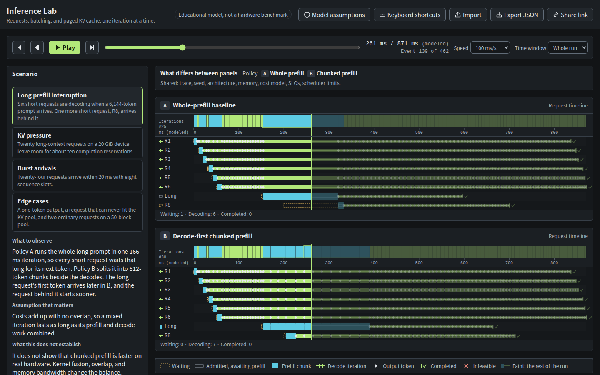

# Inference Lab

Watch requests, tokens, batching, and paged KV cache interact during LLM inference, one scheduler iteration at a time.

Inference Lab simulates one logical GPU serving a decoder-only Transformer. It runs two scheduling policies side by side on the identical request trace, so you can see why requests wait, how tokens fill KV blocks, how the batch changes over time, and how chunked prefill moves latency between requests. Everything runs in your browser. It runs no model, calls no inference API, and needs no GPU.

It is an educational model, not a hardware benchmark. Every number comes from the equations in the [model reference](docs/model.md).



## Follow your first scenario

1. Run the app locally (see below). It opens on **Long prefill interruption**.
2. Press **Play**. Six short requests start decoding. At 150 ms a 6,144-token prompt arrives.
3. Compare the two timelines. In panel A (whole-prefill baseline) the long prompt runs as one 166 ms iteration, and every short request waits that long for its next token. In panel B (decode-first chunked prefill) the prompt runs as twelve 512-token chunks beside the decodes.
4. Select an iteration bar or **Explain this iteration** to see why each request ran or waited. Select a request row to see its KV positions, blocks, reservation, and latency in both panels.
5. Read **Comparison results**. In this model chunking cuts the worst inter-token gap from 166 ms to 22 ms. It also delays the long request's first token from 171 ms to 240 ms, and lets the request behind it start in 27 ms instead of 133 ms. Switch the card to **At cursor** to see the same table for the events up to the playhead.
6. Scroll to **Over time** to see KV blocks and the batch change across the run. Select a point to move the playhead there.

`Space` plays or pauses, the arrow keys step one event, `Home` and `End` jump to the start and the end, `+` and `-` change the playback speed, and `?` lists every shortcut. **Share link** copies a link that encodes the configuration and seed. **Export JSON** downloads the configuration, trace, assumptions, every event, and the result summaries.

## What you can explore

- A request lifecycle with arrival, FIFO admission, prefill chunks, decode iterations, per-token emission times, completion, and infeasible rejection.
- A memory model with weights, a runtime allowance, and a paged KV pool. It shows actual block allocation, completion reservations, reserved headroom, logical cached tokens, and internal fragmentation per request.
- Continuous batching: requests join and leave the running batch between iterations.
- Two policies, a whole-prefill baseline and decode-first chunked prefill. Each panel can override the shared limits. A strip above the timelines lists each panel's policy, every override with both panel values, and any limit a panel's policy ignores.
- Event-derived metrics: initial queue delay, TTFT, ITL, TPOT, E2E latency, throughput, and SLO attainment with editable thresholds. Sample counts appear next to every percentile. Results show the full run by default, or the events up to the playhead.
- Over-time charts of KV blocks allocated against reserved and of batch size against the waiting queue, for both panels on the timelines' time axis.
- Four [scenarios](docs/scenarios.md): long prefill interruption, KV pressure, burst arrivals, and edge cases (a one-token output and a request that can never fit).
- Synthetic architecture presets with explicit layer, query-head, KV-head, and head-dimension counts. They do not reproduce any commercial model or GPU.
- Editable traces of up to 32 requests in the panel, and JSON import for traces of up to 512 requests.

## Run locally

Use Node.js 24 and npm, matching CI.

```sh
npm ci
npm run dev
```

Open the URL Vite prints. The development server binds to `0.0.0.0` so another device on the network can reach it.

## Test and build

```sh
npm test               # engine unit tests (node --test)
npm run typecheck      # TypeScript project references
npm run check          # unit tests, type checks, and production build
npx playwright install --with-deps chromium
npm run test:e2e       # Chromium end-to-end checks
npm run screenshot     # regenerate docs/assets/inference-lab.png from a running dev server
```

`npm run build` writes the static site to `dist`. `npm run preview` serves that build locally. Playwright starts its own dev server on port 5188 and reuses one already running there outside CI. `npm run screenshot` expects a server on that port (or `BASE_URL`) and fails if the image grows past 300 KiB.

## Deploy to Cloudflare Pages

The site is static, so any static host works. For Cloudflare Pages with Git integration:

| Setting | Value |
| --- | --- |
| Project | `inference-lab` |
| Build command | `npm run check` |
| Output directory | `dist` |
| Build environment | `NODE_VERSION=24` |

For a manual upload, authenticate Wrangler and deploy the build output. `npm run deploy` runs `npm run check` first, then uploads `dist` to the `inference-lab` project.

```sh
npx wrangler login
npm run deploy
```

Nothing in this repository deploys automatically, and the app needs no environment variables, secrets, or backend.

## Source map

| Path | Responsibility |
| --- | --- |
| `src/sim/config.ts` | Configuration types, presets, limits, and boundary validation of untrusted input |
| `src/sim/trace.ts` | Seeded integer PRNG, synthetic trace generation, and normalization into FIFO order |
| `src/sim/memory.ts` | KV bytes per token, the memory plan, completion reservations, and block ids |
| `src/sim/cost.ts` | The additive iteration cost model and zero-duration checks |
| `src/sim/scheduler.ts` | FIFO admission and the two policies, each decision returned with its reason code |
| `src/sim/state.ts` | Request phases, events, and the reducer that is the only writer of simulation state |
| `src/sim/engine.ts` | The run loop, iteration records, per-request histories, checkpoints, and `stateAt` |
| `src/sim/compare.ts` | A/B build, semantic validation, and the merged, time-synchronized event cursor |
| `src/sim/metrics.ts` | Per-request metrics, distributions, throughput, and SLO attainment |
| `src/sim/inspect.ts` | Memory breakdown and wait explanations at any cursor |
| `src/sim/series.ts` | Per-iteration samples of KV blocks, batch size, and queue length for the over-time charts |
| `src/sim/serialize.ts` | Versioned share links and JSON export and import |
| `src/sim/invariants.ts` | State audits used by tests |
| `src/ui/` | React views, the string catalog (`strings.ts`), and styles |
| `tests/` | Playwright checks |
| `scripts/` | The README screenshot generator |

The engine has no React, DOM, or npm imports, so `node --test` runs it directly. The visual system is described in [DESIGN.md](DESIGN.md).

## Adding a scheduling policy

A policy is a pure function. It reads the request states at a decision instant and returns a plan: which active requests run in the next iteration, how many tokens each, and a reason code for every request it runs or skips. The engine owns time, memory, and events, so a policy never touches them.

1. Add the id to `POLICY_IDS` in `src/sim/config.ts`. `PolicyId` derives from that list, and `parseConfig` accepts only listed ids, so share links and imports validate the new id with no other change.
2. Write `plan<Name>(input: PlanInput): Plan` in `src/sim/scheduler.ts` and register it in `POLICIES`. Give each entry an `EntryReason` and each skipped request a `SkipReason`, adding codes to those unions when the existing ones do not explain the decision. The engine throws if an entry would exceed the request's reservation or if an iteration schedules no work, so the plan must run something whenever a request is active.
3. If the policy ignores a scheduler limit, return `false` for it from `usedBy` in the same file. The configuration panel then hides that per-panel override, and the differences strip marks the limit as not used by that panel.
4. In `src/ui/strings.ts`, add the policy's name and short name to `S.policy`, text for any new reason code to the `EntryReason` and `SkipReason` catalogs, and a line to the Scheduling policies section of the model dialog. The catalogs are typed against the unions, so `npm run typecheck` fails until every id and code has text.
5. If some valid configuration cannot run under the policy, the way a whole-prefill prompt can exceed the token budget, reject it in `semanticIssues` in `src/sim/compare.ts` with a new `IssueCode` in `config.ts` and its text in `strings.ts`. The user then sees a validation message instead of an engine error.
6. Add plan cases to `src/sim/scheduler.test.ts`, and add the id to the seeded invariant test in `src/sim/engine.test.ts`, which currently alternates the two policies by trial. The cursor-consistency and over-time series tests already run every preset in both panels. Document the rules under Scheduling in `docs/model.md`.

## Understand the limits

- One logical GPU, full attention, MHA or GQA only. No MLA, sliding window, hybrid layers, tensor or pipeline parallelism, prefix caching, speculative decoding, offloading, preemption, or disaggregated prefill and decode.
- Admission reserves enough blocks for each request to finish. That is this simulator's conservative policy, not vLLM's, which admits optimistically and preempts.
- Costs are additive with no overlap, and the coefficients are chosen for readable scenarios. Modeled busy time is not GPU utilization or MFU.
- Exactly G tokens are generated per request, with no stochastic end-of-sequence.

The [model reference](docs/model.md) lists every rule and equation. The [implementation report](docs/report.md) lists what was verified and what remains open.

## Documentation

- [Model reference](docs/model.md): token conventions, allocator and reservation policy, scheduler behavior, equations, units, exclusions.
- [Scenarios](docs/scenarios.md): what each preset shows and what it does not establish.
- [Implementation report](docs/report.md): capabilities, verification, and limitations.

## References

Mechanisms are grounded in these sources. The simulator's simplifications are its own and are listed in the model reference.

- vLLM documentation, [Optimization and tuning](https://docs.vllm.ai/en/stable/configuration/optimization/) (chunked prefill and preemption).
- vLLM documentation, [Production metrics](https://docs.vllm.ai/en/stable/usage/metrics/).
- vLLM documentation, [Automatic prefix caching](https://docs.vllm.ai/en/stable/features/automatic_prefix_caching/) (outside this release).
- Kwon et al., [Efficient Memory Management for Large Language Model Serving with PagedAttention](https://arxiv.org/abs/2309.06180), SOSP 2023.

The companion project [NCCL Lab](https://nccl-lab.pages.dev/) ([source](https://github.com/ziwon/nccl-lab)) uses the same playback and inspector conventions for collective communication.
