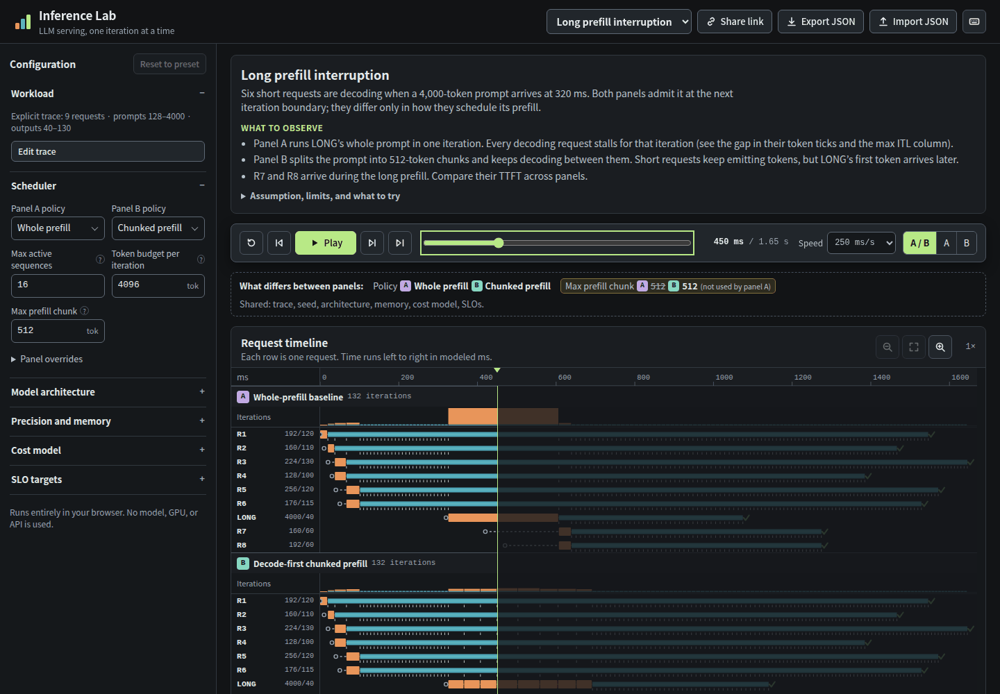

# Inference Lab

See how requests, tokens, scheduling decisions, and the KV cache interact during LLM inference, one iteration at a time.

Inference Lab simulates one logical GPU serving a request trace. It shows when each request waits, when it is admitted, how its prompt is prefilled, and when each output token appears. Two panels run the same trace under two scheduling policies, so you can compare them request by request. Everything runs in your browser. The app runs no language model and needs no GPU, backend, or API key.



*The default scenario at 450 ms. All times are modeled milliseconds from an educational cost model, not hardware measurements.*

## Follow your first scenario

1. Run the app (see [Run locally](#run-locally)). It opens on **Long prefill interruption**.
2. Press **Play**. Six short requests start decoding. At 320 ms, the 4,000-token request `LONG` arrives.
3. Watch Panel A. `LONG`'s whole prompt runs in one 281 ms iteration, and the token ticks of every other request stop during it.
4. Watch Panel B. The prompt runs in 512-token chunks, and the short requests keep emitting tokens between chunks.
5. Select an iteration bar. The **Batch inspector** lists the scheduled requests, their token counts, the remaining budget, and why each request ran or waited.
6. Select a request ID to see its prompt length, output budget, state, generated tokens, cached tokens, allocated and reserved blocks, and latency metrics.
7. Under **Results**, choose **Final** to compare TTFT, inter-token latency, and SLO outcomes for each request in both panels.

Use `Space` to play or pause, `←` and `→` to step between events, `Home` and `End` to jump, and `-` and `+` to change the speed. Shortcuts do nothing while you type in a field.

## What you can explore

- The request lifecycle: arrival, waiting, admission, prefill, decode, and completion.
- A memory model with model weights, a runtime allowance, and a paged KV cache. The memory inspector separates allocated blocks, reservation headroom, populated positions, and internal fragmentation.
- Continuous batching, with requests that enter and leave the active set at iteration boundaries.
- Two scheduling policies: a whole-prefill baseline and decode-first chunked prefill.
- A synchronized A/B comparison on the identical trace. A bar above the timeline lists every setting that differs between the panels.
- Metrics from event timestamps: queue delay, TTFT, ITL, TPOT, end-to-end latency, throughput, and SLO attainment with editable targets.
- Four presets: long prefill interruption, KV cache pressure, burst arrivals, and edge cases. The [scenario guide](docs/scenarios.md) explains what each one shows.

**Share link** copies a URL that reproduces the configuration and seed. **Export JSON** downloads the configuration, trace, assumptions, event history, and result summaries. **Import JSON** loads an export and simulates it again locally.

## Run locally

Use Node.js 22.12 or later and npm.

```sh
npm ci
npm run dev
```

Open the URL that Vite prints. The development server binds to `0.0.0.0`, so other devices on your network can open it.

## Test and build

To type-check, run the unit tests, and create a production build in one step:

```sh
npm run check
```

The individual steps are:

| Command | What it does |
| --- | --- |
| `npm run typecheck` | Runs `tsc -b` over the app and the tests. |
| `npm test` | Runs the Vitest unit tests in `src/**/*.test.ts`. |
| `npm run build` | Type-checks and writes the static site to `dist/`. |
| `npm run preview` | Serves `dist/` locally. |
| `npm run test:e2e` | Runs the Playwright tests in `tests/e2e/`. |

The end-to-end tests start a development server on port 5174. Install the browser once before the first run:

```sh
npx playwright install --with-deps chromium
npm run test:e2e
```

## Deploy to Cloudflare Pages

The build output is a static site, so any static host can serve `dist/`. The repository includes a Cloudflare Pages configuration in `wrangler.jsonc`.

To deploy from your machine:

1. Log in to Cloudflare with `npx wrangler login`.
2. If the Pages project does not exist yet, create it with `npx wrangler pages project create inference-lab --production-branch main`.
3. Run `npm run deploy`.

`npm run deploy` runs `npm run check` first. It then runs `wrangler pages deploy dist --project-name=inference-lab`. Wrangler prints the deployment URL when it finishes.

To deploy from a Git repository instead, connect the repository in the Cloudflare dashboard under **Workers & Pages**. Set the build command to `npm run build` and the build output directory to `dist`. Set the `NODE_VERSION` environment variable to `22.12.0` or later.

## Understand the model's limits

Inference Lab is an independent educational tool. It does not reproduce vLLM or any other serving engine, and it does not benchmark hardware.

- Times come from a cost model with four illustrative coefficients. Busy time is not GPU utilization or MFU.
- The model has one logical GPU and a decoder-only Transformer with full attention (MHA or GQA). Architecture presets are synthetic.
- Admission reserves every request's completion capacity up front and never preempts. vLLM admits more optimistically and can preempt and recompute.
- Weight precision changes memory only. A 4-bit model is not faster.
- Prefix caching, parallelism, disaggregated prefill and decode, speculative decoding, offloading, and preemption are outside this release.

Read the [model reference](docs/model.md) before you draw conclusions from a comparison.

## Documentation

- [Model reference](docs/model.md) defines the token conventions, memory equations, allocator and reservation policy, scheduler behavior, cost model, metrics, export format, and exclusions.
- [Scenarios](docs/scenarios.md) explains each preset: what to observe, which assumption matters, and what the result does not establish.
- [Implementation report](docs/implementation-report.md) lists the delivered capabilities, the verification, and the known limitations.

## Project layout

The simulation engine in `src/engine/` is pure TypeScript and does not import React. The UI in `src/ui/` reads only the engine's results and event log.

| Path | Contents |
| --- | --- |
| `src/engine/config.ts` | Configuration validation, input ranges, and limits. |
| `src/engine/tokens.ts` | Token and KV position conventions. |
| `src/engine/memory.ts` | Weight, KV, and block-pool sizes. |
| `src/engine/allocator.ts` | Paged block allocator with admission reservations. |
| `src/engine/policies.ts` | The two scheduling policies. |
| `src/engine/cost.ts` | The iteration cost model. |
| `src/engine/simulator.ts` | The discrete-event loop. |
| `src/engine/replay.ts` | Snapshots derived from the event log, for stepping in both directions. |
| `src/engine/metrics.ts` | Request and summary metrics. |
| `src/engine/compare.ts` | A/B differences and request-level comparison. |
| `src/engine/workload.ts` | Seeded trace generation. |
| `src/engine/scenarios.ts` | Presets and synthetic architectures. |
| `src/engine/serialization.ts` | Share links, JSON export, and validated import. |
| `src/i18n/en.ts` | All English UI strings. |
| `src/ui/` | React views: timeline, inspectors, configuration, playback, and results. |

To add a scheduling policy:

1. Add its id to `PolicyId` in `src/engine/types.ts` and to `POLICIES` in `src/engine/config.ts`. The share-link parser and the policy menus read `POLICIES`.
2. Write its selection function in `src/engine/policies.ts` and register it in `SELECTORS`.
3. Add its labels to the `policy` section of `src/i18n/en.ts`.
4. Review the code that is specific to one policy: `validatePanel` in `src/engine/config.ts`, `panelDifferences` in `src/engine/compare.ts`, and the decision text in `src/ui/describe.ts`.

TypeScript reports a missing `SELECTORS` entry or a missing label. To add a language, create a dictionary with the same shape as `en` and select it in `src/i18n/index.ts`.

## References

- Kwon et al., [Efficient Memory Management for Large Language Model Serving with PagedAttention](https://arxiv.org/abs/2309.06180), SOSP 2023.
- vLLM, [Optimization and Tuning](https://docs.vllm.ai/en/stable/configuration/optimization/).
- vLLM, [Metrics](https://docs.vllm.ai/en/stable/usage/metrics/).
- vLLM, [Automatic Prefix Caching](https://docs.vllm.ai/en/stable/features/automatic_prefix_caching/).

The interaction conventions follow the companion project [NCCL Lab](https://github.com/ziwon/nccl-viz).
